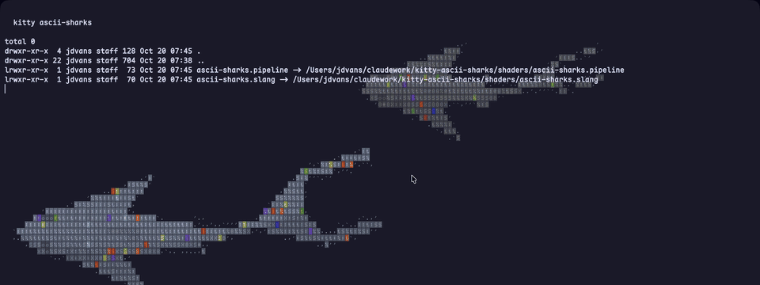

# kitty ascii-sharks

ASCII sharks that swim behind your terminal text, as a [kitty](https://sw.kovidgoyal.net/kitty/) custom shader.



Four species (classic, hammerhead, tiger, mako) cross the window in lanes, tails beating. Each shark is drawn as a grid of shaded cells with a pixel-font glyph in each: sparse `:;t` on lit skin, dense `8#@` in shadow, `o` eyes, `.'` soft edges and the odd accent colour. Terminal text and coloured cells stay on top.

Everything is procedural; there are no textures or fonts to load. It runs on the GPU and costs nothing while the window is unfocused.

## Requirements

kitty **0.49.0** or newer (custom shaders). Tested on 0.49.2, macOS.

## Install

```sh
mkdir -p ~/.config/kitty/shaders
curl -fsSL -o ~/.config/kitty/shaders/ascii-sharks.slang \
  https://raw.githubusercontent.com/Jaleel-VS/kitty-ascii-sharks/main/shaders/ascii-sharks.slang
curl -fsSL -o ~/.config/kitty/shaders/ascii-sharks.pipeline \
  https://raw.githubusercontent.com/Jaleel-VS/kitty-ascii-sharks/main/shaders/ascii-sharks.pipeline
```

Add to `kitty.conf`, then reload the config (`ctrl+shift+f5`, `cmd+ctrl+,` on macOS) or open a new window:

```conf
custom_shaders ascii-sharks
```

Try it without touching your config:

```sh
kitty -o 'custom_shaders ascii-sharks'
```

Or clone the repo and symlink the two files from `shaders/` into `~/.config/kitty/shaders/`.

## Tuning

Parameters are `static const` values at the top of `ascii-sharks.slang`. Override them with `var` lines in the pipeline file instead of editing the shader:

```
startgroup
    animation_start os-window-focus-in
    animation_stop os-window-focus-out
    animation_step 33
    var int NUM_SHARKS = 6
    var float SHARK_LENGTH = 0.45
    var float OPACITY = 0.6
    shaders ascii-sharks
endgroup
```

| Parameter | Default | Effect |
|---|---|---|
| `CELL_PX` | `float2(16, 26)` | glyph cell size in device pixels |
| `NUM_SHARKS` | `4` | number of sharks |
| `SHARK_LENGTH` | `0.6` | length of the nearest shark, in window heights |
| `SPEED` | `1.0` | swim speed multiplier |
| `OPACITY` | `0.85` | opacity of the nearest shark; farther ones are fainter |
| `ACCENT_CHANCE` | `0.06` | fraction of body cells drawn in an accent colour |
| `BEHIND_TEXT` | `true` | keep any pixel that differs from the background on top |
| `TEXT_THRESHOLD` | `0.02` | colour distance from the background that counts as text |
| `SHOW_GRID` | `true` | leave a 1px gap between cell blocks |

The pipeline animates at ~30 fps while the kitty window has focus. The sharks disappear when it loses focus; remove the `animation_start`/`animation_stop` lines to keep them swimming all the time, at the cost of rendering every frame.

## How it works

For each pixel the shader finds its glyph cell and tests the cell centre against every shark, nearest last. A shark is a spine of 14 segments built by walking back along its swim path, with a travelling wave for the tail beat. The cell centre is projected onto the spine to get body coordinates (distance from the snout, offset from the centre line), which are classified against the species outline: body half-width curve, pectoral, pelvic and tail fins as triangles, the hammerhead's cephalofoil, eyes, gills, dorsal ridge and tiger bars. Body cells are shaded as a rounded back lit from the upper left, and the shade picks the glyph.

Swim paths repeat every hour. At that point each shark may jump to a new position once.

## Credits

Inspired by [stackedlol/ascii-sharks](https://github.com/stackedlol/ascii-sharks); the species proportions and glyph ramps are adapted from it. Triangle distance function by [Inigo Quilez](https://iquilezles.org/articles/distfunctions2d/).

## License

[MIT](LICENSE)
